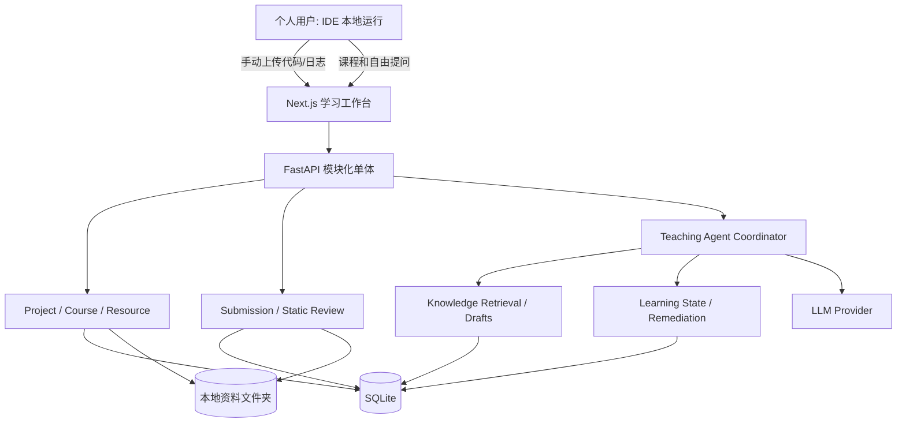

# ARCHITECTURE — Personal AI Learning Agent 目标技术设计

> 当前 StudyForge 基线与目标扩展分开描述；新模块以 TASKS 的实际验收为准。上游架构原文完整保存在 [upstream/ARCHITECTURE.md](upstream/ARCHITECTURE.md)，其中 FSRS/Tutor 尚未实现的叙述已过时，以当前源码及下述事实为准。

## 1. 上游事实基线

经源码静态核查，StudyForge 具有：
- 前端 Next.js 16 / React 19；后端 FastAPI + SQLAlchemy；SQLite。
- `backend/app/main.py` 集中现有 API；`models.py` 定义 Course/Module/Lesson/QuizItem/Attempt/ReviewCard/ReviewLog/RemediationNote/TutorMessage 等。
- `ingest.py` 支持 PDF、文字、URL、YouTube 字幕等文本提取；`generation.py` 构建课程与 Quiz。
- `tutor.py` 按 Concept 提供教学上下文；`remediation.py`、`review.py`、`fsrs.py` 实现补课和复习。
- LLM Provider 支持 Anthropic、Ollama、Gemini/OpenAI 兼容网关及用于测试的 Fake provider。
- 现有资料生成后原始来源未持久保存；缺少项目级自由会话和本地代码上传评审。

正式开发前应再次核查目标仓库 HEAD，不假定静态审查与本地代码完全一致。

### 既有调用链与兼容约束

- Next.js App Router 通过 `NEXT_PUBLIC_API_URL` 调用 FastAPI。既有路由不带 `/api` 前缀：`/courses`、`/courses/generate`、`/courses/generate/pdf`、`/quiz/{id}/answer`、`/review/*`、`/tutor/messages`、`/usage`。下文 `/api/*` 是新增模块的规划。
- 生成链路：不可信来源 → ingest 清洗分块 → outline → 逐课 author → 保存 Course/Module/Lesson/QuizItem。多来源最多 5 个、累计 150000 字符；任何来源失败时整次请求在模型调用前拒绝。
- `MeteredLLM` 统一检查预算、调用 provider、记录 token/费用/失败与 run_id。费用是估算；预算可能超出一个调用。删除课程保留费用历史，不能将费用视为账单。
- 双语：Next.js 以 `studyforge_locale` Cookie 在 SSR 和客户端间共享 zh-CN/en（默认中文），统一 API 封装转发 Accept-Language。后端请求级 ContextVar 经 ASGI middleware 隔离，并由 MeteredLLM 追加教学语言指令；原始来源、代码、JSON schema 与既有概念键不翻译。
- Quiz/Review 写入 Attempt 与 FSRS 复习记录；补课练习和 Tutor 不提高正式掌握等级。Tutor 以概念为范围，支持直接回答和两级 guided 提示。
- 课程删除会清理课程内答题和独占概念的复习历史，保留共享概念；项目归档不得调用课程删除。原始 PDF/网页尚未持久化，由 P1 补齐。
- 启动时 `create_all` 创建缺失表，`ADDED_COLUMNS` 仅支持新增列及常量默认值；不得用它做重命名、删除或重建。升级前备份，旧数据及重复启动必须回归。

## 2. 总体架构

**安全约束：上传代码仅作文本与静态分析，后端没有执行路径。**

## 3. 代码模块规划

- 保留：`ingest.py`、`generation.py`、`attempts.py`、`fsrs.py`、`review.py`、`remediation.py` 既有功能与测试。
- 新增：`projects/`（项目）、`resources/`（持久资料）、`submissions/`（手动上传与历史，静态与模型评审都在此）、`agent/`（项目级自由学习：会话、检索、引文、临时练习）、`teaching.py`（各教学端共用的教学策略）、`knowledge/`（草稿与关联）、`suggestions/`（跨项目确认）。
- 优先将新 API 写进独立 `APIRouter`，避免继续扩大 `main.py`。旧路由采用渐进迁移，不一次性重构。
- 新功能尽量复用现有 SQLAlchemy session、LLM Provider、错误响应格式与测试模式。

## 4. 数据模型（新增部分）

| 实体 | 关键字段 | 说明 |
|---|---|---|
| Project | id, name, goal, mode, status, created_at | 个人学习空间 |
| ProjectCourse | project_id, course_id, position | 多项目复用课程，删除 Project 不删除共享课程 |
| Resource | id, filename, kind, path, sha256, source_url, parse_status | 原文件与来源定位 |
| ProjectResource | project_id, resource_id | 一个资料可被多个项目引用 |
| ResourceChunk | id, resource_id, locator, text, ordinal | PDF 页码/文本片段，可全文检索 |
| Submission | id, project_id, exercise_id?, version, created_at, user_note | 一次上传/粘贴记录 |
| SubmissionArtifact | submission_id, kind, filename, content, size_bytes, sha256 | 代码、日志、配置（文本存库，便于整库备份） |
| CodeReview | id, submission_id, summary, evidence, model, created_at | 静态分析结果及证据等级 |
| AgentSession | id, project_id, mode, title, updated_at | 项目级自由对话；会话不跨项目 |
| AgentMessage | session_id, role, body, beyond, check_question, source_refs, grounded, model, run_id | 消息与出处快照（非外键，资料删除后仍可追溯） |
| KnowledgeEntry | id, project_id?, title, body, kind, concept_key, status, provenance, updated_at | 草稿/待审/确认知识，正文存 SQLite |
| KnowledgeRevision | knowledge_id, version, title, body, kind, concept_key, status, reason | 创建、编辑和确认的不可变快照 |
| ErrorCause | project_id, knowledge_id?, concept_key, cause, source_kind, source_id?, detail, dismissed_at | 错因证据与主动复习队列的来源，界面已集成 |
| ProjectKnowledge | project_id, knowledge_id, relation | 知识与项目关联 |
| KnowledgeRelation | from_id, to_id, kind | 前置依赖、相关、扩展 |
| LearningSuggestion | id, source_project_id, target_project_id, source_error_id, concept_key, evidence, state, target_error_id?, decided_at? | 基于错因的跨项目复习建议；接受前不写目标项目 |
| LearningEvidence | id, knowledge_id, project_id, submission_id?, evidence_type | 掌握判断依据 |

考虑 StudyForge 现有 Concept 可能按字符串键记录：新知识实体须先定义规范化映射策略，避免直接重写旧 ReviewCard 的 concept key。

### 数据删除原则

- 删除项目默认采用归档或软删除；不可误删多项目共享课程和复习记录。
- 删除文件时检查引用数；删除前预览受影响记录。
- 新增结构使用迁移脚本；旧数据库先做备份及迁移回归。

## 5. 计划中的 API

| Method | Route | 功能 |
|---|---|---|
| GET/POST | `/api/projects` | 项目列表/创建 |
| GET/PATCH | `/api/projects/{id}` | 项目详情/修改 |
| POST | `/api/projects/{id}/archive` | 归档 |
| GET/POST | `/api/projects/{id}/resources` | 资料列表/上传 |
| GET/POST | `/api/projects/{id}/submissions` | 提交列表/上传 |
| GET | `/api/submissions/{id}` | 查看一次提交 |
| POST | `/api/submissions/{id}/review` | 触发 AI 静态审查 |
| GET | `/api/submissions/{id}/reviews` | 评审历史 |
| GET/POST | `/api/projects/{id}/sessions` | 项目会话 |
| POST | `/api/sessions/{id}/messages` | 发送教学消息（回答 + 引文） |
| POST | `/api/sessions/{id}/practice` | 由提问生成临时讲解与一道练习草稿 |
| GET | `/api/projects/{id}/knowledge` | 项目知识 |
| POST | `/api/knowledge/{id}/confirm` | 确认知识 |
| GET | `/api/projects/{id}/suggestions` | 跨项目建议 |
| POST | `/api/suggestions/{id}/decide` | 接受/拒绝 |

API 是**目标草案**，Codex 要先核对上游风格，并维护 Pydantic schema / 前端契约测试。

P3 已交付自由学习子集：GET/POST `/api/projects/{id}/sessions`、GET/DELETE `/api/sessions/{id}`、POST `/api/sessions/{id}/messages`、POST `/api/sessions/{id}/practice`。检索仅限本项目 `resource_chunks`（FTS5 优先，有界 LIKE 回退覆盖中文与带标点提问），引文以 S1..Sn 标记给出并在落库前剔除未提供的标记；模型失败或输出不可解析时不落库。详见 ADR-019。

P1-01 已交付 Project 子集：GET/POST `/api/projects`、GET/PATCH `/api/projects/{id}`、POST `/api/projects/{id}/archive`、PUT/DELETE `/api/projects/{id}/courses/{course_id}`。列表返回 `{items,total}`，默认 active，支持 status/limit/offset；详情包含课程引用。归档只读且保留课程历史；解除关联不调用 Course 删除。其余上表接口仍以 TASKS 为准。

## 6. 教学状态机

`LEARNING -> PRACTICING -> REVIEWING_SUBMISSION -> DIAGNOSING -> REMEDIATING -> RETESTING -> COMPLETED`

自由学习允许进入 `EXPLORING`，其输出可形成 `KnowledgeEntry(draft)`。状态属于业务决策，不代表每次必须调用一次 LLM。User 始终可以选择跳过、查看参考答案、切换项目。

状态迁移由掌握证据驱动，不由日期驱动：`REVIEWING_SUBMISSION` 之后是否进入 `REMEDIATING`/`RETESTING` 取决于本次评审证据与用户选择；FSRS 仅作为底层记忆强度数据，不按到期日生成强制任务（ADR-017）。

### 教学提示分层

1. **System**：真实证据、内容安全、禁止声称执行代码、尊重确认权。
2. **Project**：目标、课程、资料和相关知识。
3. **Task**：用户题目与本次上传代码/日志。
4. **Policy**：直接讲解、分级提示、代码审查、复测。
5. **Output**：结论、对应源码片段、证据等级、知识关联、可操作下一步。

不把整个聊天记录无限拼接；结构化持久化必要事实，检索当前相关片段。

## 7. 静态评审证据模型

评审发现 `Finding` 建议含 `file`, `line_start`, `line_end`, `category`, `severity`, `evidence_type`, `description`, `suggestion`：

- `confirmed_static`：代码静态可确认（如某语句会改变 Tensor rank 的规则）。
- `user_reported`：上传日志/截图所记录的现象。
- `inferred`：依据信息推断，但尚未验证。
- `needs_local_check`：需用户在本地运行某项检查。

不得出现服务端已执行测试的状态；允许给用户复制的测试建议，但执行由用户完成。

## 8. 资料与知识处理

来源文件 → 文件类型/大小检查 → 安全解析 → 可定位 Chunk → AI 生成知识草稿 → 去重/关联建议 → 审核状态。使用 SQLite FTS5；向量检索、图数据库不是 MVP 依赖。当前知识正文、版本、状态、关联统一由 SQLite 保存，未实现独立 Markdown 文件导出，避免双写不一致。

P4 已实现：项目自由问答和临时讲解在回答引用本项目资料时，以同一数据库事务自动保存 note/draft；只复制有来源正文和出处，不复制 beyond 扩展，不增加模型调用。同标题返回已有条目，相近标题只生成候选，不合并或覆盖。核心定义/标准答案初始待审核，修改确认稿退回待审核。

浏览器编辑与确认携带 `expected_updated_at`；服务端在项目写锁后刷新条目并比较时间点，不匹配返回 409，前端保留未保存文字，需明确操作才载入保存内容。旧 API 调用方不传令牌时保留原有语义。版本差异有长度上限，界面明确提示省略和截断。知识确认状态与学习掌握状态独立。

错因服务只写 `error_causes`，不写 ReviewCard/ReviewLog。手工诊断不能伪造 Attempt/Submission 证据；错题端点检查所属项目课程、答题是否错误并快照证据。评审证据端点 `POST /api/projects/:id/errors/from-review` 只接收评审 ID、发现索引、用户所选概念和错因；服务端核验项目并读取原 finding，不接收客户端证据正文，不把分类名自动升级为正式知识概念。info 与 needs_local_check 不能作为错误诊断来源。

`/projects/:id/review-tasks` 展示错因聚合、证据、知识链接和主动复习。`GET /api/projects/:id/review-tasks/practice?concept=...` 按开放错因选择已有卡及项目关联课程题目，忽略 due；GET 不创建卡。缺卡或缺题明确提示先阅读或本地实践，不伪造测验。复用 ReviewSession 和既有答题/自评接口，主动模式隐藏下次复习间隔并返回项目。后续 rating >= 2 自评关闭此前错因，Again 保持任务；关闭仅表示已复习/自评，不证明代码修复成功或掌握等级提升。用户忽略最近一条诊断会保留历史，其他未解决诊断仍可见。

来源清楚标记为「原文事实」「AI 整理」「AI 扩展」。网页不能默认全文重新分发；注意版权和抓取许可。外部资料中的命令和提示不得提升为系统权限。

### 8.1 跨项目建议实现

独立 `suggestions/` 模块按 models/schemas/service/router 分层。用户从项目错因选择目标项目，`POST /api/projects/:id/suggestions` 保存 pending 建议及来源快照，目标仅只读校验；GET 可从来源或目标项目查看。`POST /api/suggestions/:id/decision` 接受 accepted 或拒绝 rejected。数据库唯一约束 `(source_error_id, target_project_id)` 去重，同一决定重试幂等，反向决定返回 409。

决策先通过 UPDATE 取得 SQLite 写锁并刷新状态，接受才调用目标项目写保护并新增 ErrorCause，`errors.record(commit=False)` 与建议状态在同一事务提交。拒绝只更新建议行，目标项目更新时间、知识、课程、FSRS 均不变。已关闭来源错因不能被旧建议重新使用，新的同概念错误也不会复活旧证据。归档来源或目标阻止接受，但可以拒绝；读取保留历史。

建议只添加知识驱动复习任务，不设置日期、不改核心知识、不提升掌握度。当前由用户选择跨项目目标，不引入额外模型调用；界面展示来源/目标当前名称；建议保存来源证据快照、创建/决定时间及生成的任务 ID。目标错因明确标注由用户接受跨项目建议创建，不能当作目标项目的实测失败。

### 8.2 课程知识树与证据驱动推荐

`curriculum/` 只读投影既有 Course → Module → Lesson → KnowledgePoint（概念键），入口 `GET /api/projects/:id/curriculum` 与 `/projects/:id/learn`。不新增/迁移课程表、不复制答题、不改原概念键或 FSRS。Lesson.concepts 与 QuizItem.concept 合并为展示节点，ProjectKnowledge 补充自由学习知识节点；前置关系只取本项目显式 KnowledgeRelation 及人工配置的教学建议，不从课时顺序推断。

正式练习证据仅取项目关联课程内的 lesson_quiz 每题首答及 review_session 作答；同题重试和 remedial_practice 不直接支持进阶。无证据 unassessed、有证据 learning、最近正式答错/开放错因 needs_review；最近三次正式作答正确且涉及至少两题时 ready_for_advanced。它是建议，不写正式掌握等级，不用 stability/due/retrievability 或日历推移降级。推荐按错因、待补先修、基础、巩固、进阶/综合组织，始终允许自由跳转。

教材目录只用于阅读定位：别名不合并历史，多个同义节点不要求逐个重复学习；选已有充分证据的先修节点，否则取一个对应节点。白名单核对了 D2L 中文版 2.1、2.3、2.5、10.3、10.7 章节；Visual tokens/多模态/Radar/VLM 是路径扩展建议，不声称已创建完整课程或已核实教材内容。未知主题不伪造出处。准备提问仅创建空会话并传可编辑草稿，不自动调用模型；发送后走既有检索、引文、临时练习与提交链路。

### 8.3 版本绑定的内容审核

`content_reviews/` 为课时正文（公式/示例）及主动揭示的参考解法建立来源快照，生成 definition/standard_answer 的 pending_review KnowledgeEntry，复用知识编辑、确认和不可变版本。独立 ContentReview 表保存项目、source_kind/source_id、归一化正文及标题的 SHA256、knowledge_id；唯一约束阻止同一版重复导入。来源绑定与知识首版同事务提交，不修改原课程或解法。

创建接口仅接收来源定位，服务器核验课时的项目课程关联或评审的项目提交归属；尚未主动揭示的解法返回 409。超长正文超过知识上限时拒绝，不截断后声称整篇已审核。原文这一版本已审标志纯派生：来源仍属于项目且哈希不变，审核知识稿已确认、类型及正文与来源一致。修改审核稿再确认不会自动把原文标为已审；来源删除/变化/解绑后历史审核稿保留，但标志失效。

前端课程树与已揭示解法提供审核入口，项目 `/content-reviews` 列表显示版本标识及失效原因。普通快照不解除 AI 未验证标签，任何确认均不表示代码实测成功。当前仅完成审核机制，基础公式、示例与解法的实际核对仍在 P5-02 进行中。

## 9. 文件与隐私

允许 `.py`, `.txt`, `.md`, `.log`, `.json`, `.yaml`, `.yml`, `.pdf`, `.docx`；ZIP 只作为受限的纯文本/源码归档解析，不解压到任意目标路径、不运行其中任何内容。限制大小、数量和扩展名，文件名随机化、SHA256 标记、禁止绝对路径/目录穿越。识别可能的密码、令牌、私密目录并提示用户检查。

数据目录须加入 `.gitignore`；备份 SQLite + Resource + Markdown 知识文件。

## 10. 测试策略

- `backend/tests/`：Project/Resource/Submission CRUD、权限边界（即无多用户）、非法路径、超限文件、恶意 ZIP、知识审核、跨项目确认和数据删除。
- Agent 回归：固定样例中广播错误应识别，但不能声称运行；本地日志与源码冲突时必须说明不确定性。
- `frontend/tests/`：项目切换、上传状态、评审反馈、知识审核、确认按钮。
- 旧课程、FSRS、Tutor 等测试不得回归；假模型运行可重复评估。
- 打包/构建与手动端到端验收需记录真实日志，无法运行则标记 `BLOCKED`。

## 11. 关键风险

### 首页与主题

- `lib/theme.ts` 是双主题颜色的唯一来源；RootLayout 使用异步 Cookie API 读取 `studyforge_theme`，直接在 HTML 输出颜色变量和 `color-scheme`，默认浅色。ThemeProvider 切换 Cookie、根变量与 React 上下文；不依赖系统深色偏好。
- Ant Design ConfigProvider、现有 Vant 控件和 ECharts 使用相同主题；Vant 的 body 级 Portal 通过根变量适配。JobTrace 使用语义化列表、独立 360px 滚动区域和原生 details，保留调用 ID、摘要、记录顺序。
- AppShell 仅在 `/` 隐藏侧栏，业务路由保持现有壳与入口。首页读取真实课程；后端不可用和空课程分开呈现。没有自动生成示例课程或调用模型。
- 深色首页通过原生滚动/RAF 和 CSS 动画驱动球体及课程条；浅色首页使用原生视频及渐变降级背景。静态字体及 OFL 许可证位于 `public/fonts`，构建不访问 Google Fonts。

1. `main.py` / `tutor.py` 过大，需增量模块化。
2. 原始资料未持久化，必须优先补资源层。
3. 原 Tutor 强绑定 Concept，不宜简单添加 Prompt 作为自由 Agent。
4. 自定义 SQLite add-column 机制有限，复杂关联需要正式迁移。
5. LLM 静态评审可能误判；以证据分级、复核和可重复样例降低风险。

## 单人访问门禁（2026-10-24）

- `backend/app/auth/`：统一 ASGI 认证与跨站写请求校验、密码登录、会话续期和撤销；全部业务路由（含附件、下载、流式接口、OpenAPI 文档）受保护。仅 `/health` 与 `/auth/*` 认证入口豁免业务 access 校验；续期必须提供有效 refresh token。未配置密码返回 503。
- `auth_sessions`：新增表，记录随机会话 ID、refresh token 的 HMAC 摘要、创建/绝对过期时间；不改动学习数据。`init_db()` 通过既有 `create_all` 幂等创建。回滚代码时可保留该独立表，不必删除或恢复学习数据。
- access token：HMAC 签名，15 分钟有效，服务端逐次检查会话存在及未过期；refresh token：随机不透明令牌，HttpOnly Cookie，7 天绝对有效且续期不延期。数据库不保存原始 token。退出删除会话，改密码使旧签名与摘要失效。两种 Cookie 均 SameSite=Lax，HTTPS 下 Secure。
- Next.js `src/proxy.ts` 在页面渲染前调用后端 `/auth/session`，过期 access 由 refresh 换发，并将新 Cookie 同时转交 SSR 和浏览器。未登录页面跳 `/login?next=...`，API 返回 401。后端不可用时关闭访问，返回 503。
- 浏览器请求统一经 `/backend/[...path]` 同源流式转发到固定配置的后端；SSR API 请求转发当前 Cookie。转发仅允许必要请求头，不改变上传与 SSE 响应体。侧栏接口复用同一 API 封装。
- 生产/本地配置：在根 `.env` 或 `backend/.env` 设置 `ADMIN_PWD`（后者优先；系统环境变量优先于文件），重启后端生效；前端使用 `API_INTERNAL_URL` 指定服务端后端地址，默认本机 8000。修改访问域名或端口时，`STUDYFORGE_CORS_ORIGINS` 必须列出实际前端 Origin。密码不使用 `NEXT_PUBLIC_` 前缀。浏览器通过同源路径访问，不依赖直连后端的 CORS 凭据。
- 登录限流为本地单 worker 的 60 秒最多 10 次尝试；扩展多 worker 前需要共享限流存储。refresh token 在其固定期限内可重复换发 access，退出/改密/过期均撤销；不扩展设备管理或账号体系。

## 私有服务器运行（2026-10-24）

用户授权单人私有服务器部署：Next.js / FastAPI 原生 systemd 运行，Nginx 内部转发接入既有 HTTPS 首页，保留原模型网关。数据库与资料独立存放于 `/var/lib/studyforge`，部署配置在 `/etc/studyforge`，版本目录与运行数据分离。采用一次性本地快照迁移，后续网站为准；用户代码仍仅在自己的本地环境运行。具体路径、来源校验、备份与回滚见 [DEPLOYMENT.md](DEPLOYMENT.md) 与 ADR-035。
