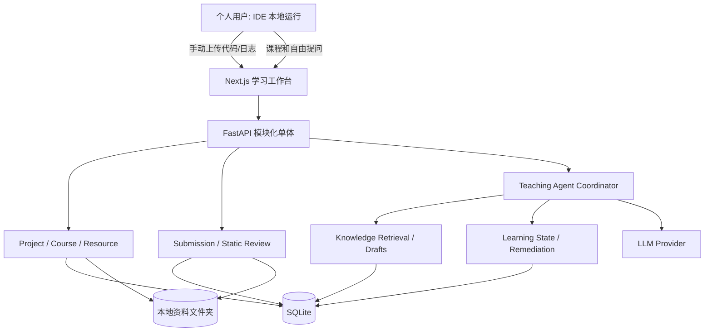

# ARCHITECTURE — Personal AI Learning Agent 目标技术设计

> 当前 StudyForge 基线与目标扩展分开描述；新模块以 TASKS 的实际验收为准。上游架构原文完整保存在 [upstream/ARCHITECTURE.md](upstream/ARCHITECTURE.md)，其中 FSRS/Tutor 尚未实现的叙述已过时，以当前源码及下述事实为准。

## 1. 上游事实基线

经源码静态核查，StudyForge 具有：
- 前端 Next.js 16 / React 19；后端 FastAPI + SQLAlchemy；SQLite。
- `backend/app/main.py` 集中现有 API；`models.py` 定义 Course/Module/Lesson/QuizItem/Attempt/ReviewCard/ReviewLog/RemediationNote/TutorMessage 等。
- `ingest.py` 支持 PDF、文字、URL、YouTube 字幕等文本提取；`generation.py` 构建课程与 Quiz。
- `tutor.py` 按 Concept 提供教学上下文；`remediation.py`、`review.py`、`fsrs.py` 实现补课和复习。
- LLM Provider 支持 Anthropic、Ollama、用于测试的 Fake provider。
- 现有资料生成后原始来源未持久保存；缺少项目级自由会话和本地代码上传评审。

正式开发前应再次核查目标仓库 HEAD，不假定静态审查与本地代码完全一致。

### 既有调用链与兼容约束

- Next.js App Router 通过 `NEXT_PUBLIC_API_URL` 调用 FastAPI。既有路由不带 `/api` 前缀：`/courses`、`/courses/generate`、`/courses/generate/pdf`、`/quiz/{id}/answer`、`/review/*`、`/tutor/messages`、`/usage`。下文 `/api/*` 是新增模块的规划。
- 生成链路：不可信来源 → ingest 清洗分块 → outline → 逐课 author → 保存 Course/Module/Lesson/QuizItem。多来源最多 5 个、累计 150000 字符；任何来源失败时整次请求在模型调用前拒绝。
- `MeteredLLM` 统一检查预算、调用 provider、记录 token/费用/失败与 run_id。费用是估算；预算可能超出一个调用。删除课程保留费用历史，不能将费用视为账单。
- Quiz/Review 写入 Attempt 与 FSRS 复习记录；补课练习和 Tutor 不提高正式掌握等级。Tutor 以概念为范围，支持直接回答和两级 guided 提示。
- 课程删除会清理课程内答题和独占概念的复习历史，保留共享概念；项目归档不得调用课程删除。原始 PDF/网页尚未持久化，由 P1 补齐。
- 启动时 `create_all` 创建缺失表，`ADDED_COLUMNS` 仅支持新增列及常量默认值；不得用它做重命名、删除或重建。升级前备份，旧数据及重复启动必须回归。

## 2. 总体架构

**安全约束：上传代码仅作文本与静态分析，后端没有执行路径。**

## 3. 代码模块规划

- 保留：`ingest.py`、`generation.py`、`attempts.py`、`fsrs.py`、`review.py`、`remediation.py` 既有功能与测试。
- 新增：`projects/`（项目）、`resources/`（持久资料）、`submissions/`（手动上传与历史）、`code_review/`（静态评审与日志）、`agent/`（教学协调器）、`knowledge/`（草稿与关联）、`suggestions/`（跨项目确认）。
- 优先将新 API 写进独立 `APIRouter`，避免继续扩大 `main.py`。旧路由采用渐进迁移，不一次性重构。
- 新功能尽量复用现有 SQLAlchemy session、LLM Provider、错误响应格式与测试模式。

## 4. 数据模型（新增部分）

| 实体 | 关键字段 | 说明 |
|---|---|---|
| Project | id, name, goal, mode, status, created_at | 个人学习空间 |
| ProjectCourse | project_id, course_id, position | 多项目复用课程，删除 Project 不删除共享课程 |
| Resource | id, filename, kind, path, sha256, source_url, parse_status | 原文件与来源定位 |
| ProjectResource | project_id, resource_id | 一个资料可被多个项目引用 |
| ResourceChunk | id, resource_id, locator, text, ordinal | PDF 页码/文本片段，可全文检索 |
| Submission | id, project_id, exercise_id?, version, created_at, user_note | 一次上传/粘贴记录 |
| SubmissionArtifact | submission_id, type, path, sha256 | 代码、日志、配置 |
| CodeReview | id, submission_id, summary, evidence, model, created_at | 静态分析结果及证据等级 |
| AgentSession | id, project_id, mode, created_at | 项目级自由/课程对话 |
| AgentMessage | session_id, role, body, source_refs | 消息与出处 |
| KnowledgeEntry | id, title, markdown_path, status, provenance | 草稿/待审/确认知识 |
| ProjectKnowledge | project_id, knowledge_id, relation | 知识与项目关联 |
| KnowledgeRelation | from_id, to_id, kind | 前置依赖、相关、扩展 |
| LearningSuggestion | id, from_project_id, to_project_id, action, state | 跨项目修改需确认 |
| LearningEvidence | id, knowledge_id, project_id, submission_id?, evidence_type | 掌握判断依据 |

考虑 StudyForge 现有 Concept 可能按字符串键记录：新知识实体须先定义规范化映射策略，避免直接重写旧 ReviewCard 的 concept key。

### 数据删除原则

- 删除项目默认采用归档或软删除；不可误删多项目共享课程和复习记录。
- 删除文件时检查引用数；删除前预览受影响记录。
- 新增结构使用迁移脚本；旧数据库先做备份及迁移回归。

## 5. 计划中的 API

| Method | Route | 功能 |
|---|---|---|
| GET/POST | `/api/projects` | 项目列表/创建 |
| GET/PATCH | `/api/projects/{id}` | 项目详情/修改 |
| POST | `/api/projects/{id}/archive` | 归档 |
| GET/POST | `/api/projects/{id}/resources` | 资料列表/上传 |
| GET/POST | `/api/projects/{id}/submissions` | 提交列表/上传 |
| GET | `/api/submissions/{id}` | 查看一次提交 |
| POST | `/api/submissions/{id}/review` | 触发 AI 静态审查 |
| GET | `/api/submissions/{id}/reviews` | 评审历史 |
| GET/POST | `/api/projects/{id}/sessions` | 项目会话 |
| POST | `/api/sessions/{id}/messages` | 发送教学消息 |
| GET | `/api/projects/{id}/knowledge` | 项目知识 |
| POST | `/api/knowledge/{id}/confirm` | 确认知识 |
| GET | `/api/projects/{id}/suggestions` | 跨项目建议 |
| POST | `/api/suggestions/{id}/decide` | 接受/拒绝 |

API 是**目标草案**，Codex 要先核对上游风格，并维护 Pydantic schema / 前端契约测试。

## 6. 教学状态机

`LEARNING -> PRACTICING -> REVIEWING_SUBMISSION -> DIAGNOSING -> REMEDIATING -> RETESTING -> COMPLETED`

自由学习允许进入 `EXPLORING`，其输出可形成 `KnowledgeEntry(draft)`。状态属于业务决策，不代表每次必须调用一次 LLM。User 始终可以选择跳过、查看参考答案、切换项目。

### 教学提示分层

1. **System**：真实证据、内容安全、禁止声称执行代码、尊重确认权。
2. **Project**：目标、课程、资料和相关知识。
3. **Task**：用户题目与本次上传代码/日志。
4. **Policy**：直接讲解、分级提示、代码审查、复测。
5. **Output**：结论、对应源码片段、证据等级、知识关联、可操作下一步。

不把整个聊天记录无限拼接；结构化持久化必要事实，检索当前相关片段。

## 7. 静态评审证据模型

评审发现 `Finding` 建议含 `file`, `line_start`, `line_end`, `category`, `severity`, `evidence_type`, `description`, `suggestion`：

- `confirmed_static`：代码静态可确认（如某语句会改变 Tensor rank 的规则）。
- `user_reported`：上传日志/截图所记录的现象。
- `inferred`：依据信息推断，但尚未验证。
- `needs_local_check`：需用户在本地运行某项检查。

不得出现服务端已执行测试的状态；允许给用户复制的测试建议，但执行由用户完成。

## 8. 资料与知识处理

来源文件 → 文件类型/大小检查 → 安全解析 → 可定位 Chunk → AI 生成知识草稿 → 去重/关联建议 → 审核状态。最初使用 SQLite FTS5；向量检索、图数据库不是 MVP 依赖。Markdown 为知识正文的可读导出格式，SQLite 为索引、状态和关联的权威记录；两者修改需要保持一致。

来源清楚标记为「原文事实」「AI 整理」「AI 扩展」。网页不能默认全文重新分发；注意版权和抓取许可。外部资料中的命令和提示不得提升为系统权限。

## 9. 文件与隐私

允许 `.py`, `.txt`, `.md`, `.log`, `.json`, `.yaml`, `.yml`, `.pdf`, `.docx`；ZIP 只作为受限的纯文本/源码归档解析，不解压到任意目标路径、不运行其中任何内容。限制大小、数量和扩展名，文件名随机化、SHA256 标记、禁止绝对路径/目录穿越。识别可能的密码、令牌、私密目录并提示用户检查。

数据目录须加入 `.gitignore`；备份 SQLite + Resource + Markdown 知识文件。

## 10. 测试策略

- `backend/tests/`：Project/Resource/Submission CRUD、权限边界（即无多用户）、非法路径、超限文件、恶意 ZIP、知识审核、跨项目确认和数据删除。
- Agent 回归：固定样例中广播错误应识别，但不能声称运行；本地日志与源码冲突时必须说明不确定性。
- `frontend/tests/`：项目切换、上传状态、评审反馈、知识审核、确认按钮。
- 旧课程、FSRS、Tutor 等测试不得回归；假模型运行可重复评估。
- 打包/构建与手动端到端验收需记录真实日志，无法运行则标记 `BLOCKED`。

## 11. 关键风险

1. `main.py` / `tutor.py` 过大，需增量模块化。
2. 原始资料未持久化，必须优先补资源层。
3. 原 Tutor 强绑定 Concept，不宜简单添加 Prompt 作为自由 Agent。
4. 自定义 SQLite add-column 机制有限，复杂关联需要正式迁移。
5. LLM 静态评审可能误判；以证据分级、复核和可重复样例降低风险。
